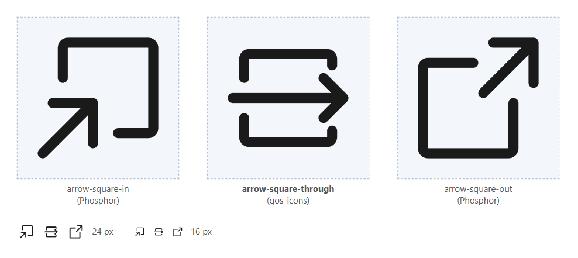

# @m9aertner/gos-icons

Gate Operating System (GOS) specific icons in the style of [Phosphor Icons](https://phosphoricons.com) ("regular" weight, 256 x 256 grid), as icon font and as SVG. Complements `@phosphor-icons/web` (font) and `@phosphor-icons/core` (SVG), does not replace them.



**`arrow-square-through`**: an arrow passing straight through a square, in and out in one step. Drawn in the style of [Phosphor Icons](https://phosphoricons.com) as a sibling of `arrow-square-in` and `arrow-square-out`.

Published as the npm package `@m9aertner/gos-icons`, as icon font and as SVG. It complements `@phosphor-icons/web` (font) and `@phosphor-icons/core` (SVG) and does not replace them.

## Add the icon to your project

### 1. Install

Add the release tarball to the `devDependencies` (or `dependencies`) in your `package.json`:

```json
"@m9aertner/gos-icons": "https://github.com/m9aertner/gos-icons/releases/download/v1.0.0/m9aertner-gos-icons-1.0.0.tgz"
```

and run `npm install`. npm records the download URL and an integrity hash in `package-lock.json`.

Without network access to GitHub: download `m9aertner-gos-icons-1.0.0.tgz` from the [releases](https://github.com/m9aertner/gos-icons/releases) (or take it from `release/1.0.0/` of this repository) and run `npm install --save-dev ./m9aertner-gos-icons-1.0.0.tgz`.

### 2. Load the icon font

The icon font works together with the regular Phosphor icon font: `@phosphor-icons/web/regular` provides the `ph` base class, this package only swaps in its own glyph font for the new icon. Load both in the global stylesheet of your app, Phosphor first.

SCSS (`src/styles.scss`):

```scss
@use 'sass:meta';
@include meta.load-css('@phosphor-icons/web/regular');
@include meta.load-css('@m9aertner/gos-icons/regular');
```

Plain CSS bundlers:

```css
@import '@phosphor-icons/web/regular';
@import '@m9aertner/gos-icons/regular';
```

Without a bundler, link `node_modules/@m9aertner/gos-icons/src/regular/style.css` (it references `GosIcons.woff2`, `.woff` and `.ttf` next to it).

### 3. Use it

Exactly like any other Phosphor icon: classes `ph` and `ph-arrow-square-through`.

```html
<i class="ph ph-arrow-square-through"></i>
<p-button icon="ph ph-arrow-square-through" />
```

The icon takes size from `font-size` and colour from `color`, as the other `ph` icons do:

```css
.my-toolbar i.ph-arrow-square-through { color: #004393; font-size: 24px; }
```

### 4. Check

Open the page. If you see an empty box or a missing glyph instead of the icon, the font file is not found or `@m9aertner/gos-icons/regular` is loaded without `@phosphor-icons/web/regular`. In the browser dev tools the `::before` of the `<i>` must show `font-family: GosIcons`.

### SVG instead of font

Same single-path format as `@phosphor-icons/core/regular/*.svg`, so it can be handled the same way, for example for a canvas or an inline `<svg>`:

```ts
import arrowSquareThroughSvg from '@m9aertner/gos-icons/regular/arrow-square-through.svg';
```

```html
<svg viewBox="0 0 256 256" fill="currentColor"><path d="..." /></svg>
```

## Icons

| Name | Meaning | Codepoint |
| --- | --- | --- |
| `arrow-square-through` | Passes through the square, in and out in one step. | `U+EE84` |

Design of `arrow-square-through`:

- 256 x 256 grid, "regular" weight (stroke 16, round caps and joins), like Phosphor.
- One horizontal arrow on the centre line, from the left edge to the right edge of the glyph. Its head is the head of `arrow-square-in`, turned 45 degrees clockwise and reduced by 30%.
- Square of 156 x 156 centred in the grid, outer corner radius 16 like the Phosphor squares. The left side is open where the arrow starts, the right side is reduced to short hooks at the corners so that the arrow head has clear space.
- The visual weight is on the right, the exit side.

Codepoint: `U+EE84` is the first codepoint above the highest one used by Phosphor Icons 2.1.1 (`U+EE83`, in all weights including both duotone layers), so it overlaps with no Phosphor glyph and the icon could be proposed upstream as it is. When adding icons, continue upwards from the highest codepoint in `glyphs.json`.

## Repository layout and build

```
design/       input: stroked drawing (<name>.stroke.svg); review page and image (preview.html, preview.png)
glyphs/       filled outline (<name>.svg), generated from design/ by step 1; the font is built from this
glyphs.json   name -> private-use codepoint; never change or reuse an assigned codepoint
package/      package.json (holds the version) and README.md of the published package
scripts/      stroke_to_outline.py (step 1), build_gos_icons.py (step 2)
release/      built tarball and SHA256SUMS per version, as attached to the GitHub release
dist/         build output, git-ignored
```

Needs Python 3 and Node/npm (for `npm pack`).

```
pip install -r requirements.txt
python scripts/stroke_to_outline.py    # design/*.stroke.svg -> glyphs/*.svg
python scripts/build_gos_icons.py      # glyphs/*.svg -> dist/m9aertner-gos-icons-<version>.tgz
```

The build is reproducible: the same inputs and tool versions (`requirements.txt`) give a byte-identical tarball.

### Add or change an icon

1. Draw it on the 256 grid with strokes of width 16 (round caps and joins) as `design/<name>.stroke.svg`: one `<path d="...">` per stroke, `stroke-width="16"` on the root.
2. Add the name and a new codepoint to `glyphs.json`.
3. Run both steps. Compare the result with the Phosphor originals in `design/preview.html`.
4. Raise `version` in `package/package.json`.

### Release

1. Run both steps, copy `dist/m9aertner-gos-icons-<version>.tgz` to `release/<version>/`, and write `SHA256SUMS` there.
2. Commit, tag `v<version>`, push the tag.
3. Create the GitHub release for the tag and attach the tarball from `release/<version>/`.

## License

[MIT](LICENSE). The glyphs are derived from the design of Phosphor Icons, Copyright (c) 2023 Phosphor Icons, whose license notice is retained.
